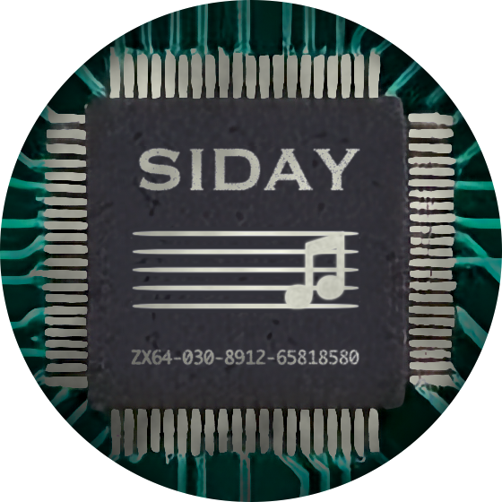

# siday

A player of chiptunes and tracker modules written entirely in Swift, in two forms: **a page that
plays in your browser**, and a command-line player for macOS. Both are the same emulators underneath:
of the sound chips of the ZX Spectrum, the Amstrad CPC, the Atari ST, the 8-bit Ataris, the Commodore
64, the Amiga and the PC's AdLib and Sound Blaster cards, and of the trackers that played modules on the Amiga and the PC.

The name is the two families of sound chip it began with, SID and AY. How to pronounce it is left open.

**In a browser:** open **[ptsochantaris.github.io/siday](https://ptsochantaris.github.io/siday/)** and
drop tunes or a whole folder on the page. Nothing is uploaded: they are played where they are. See
[In a browser](#in-a-browser).

**On the command line:** point it at files, folders or playlists. See [On the command line](#on-the-command-line).

```
siday ~/Music/chiptunes --shuffle
```

## What it plays

| For | Formats | Played by |
|---|---|---|
| ZX Spectrum, Amstrad CPC | PT3, PT2, PT1, STC, STP, ASC, PSC, SQT, FTC, FXM, PSM, GTR, and TurboSound pairs; VTX and YM register recordings; AY program rips, beeper music included | each tracker's own player, or the tune's own program on a Z80, on the AY chip |
| Atari ST and STE | SNDH, packed with Ice or not; YM files from the ST, with its timer effects; sample tunes (MIX1, YMT1, YMT2) | the tune's own program on a 68000, on the ST's sound chip and the STE's samples |
| Atari 400, 800, XL and XE | SAP, for one POKEY or two | the tune's own program on a 6502, on the POKEY |
| Commodore 64 | SID (PSID and RSID) | the tune's own program on a C64, with either of two emulations of the SID chip |
| Amiga | MOD and its many packed forms, and over twenty other trackers and music systems: see [On the Amiga](#on-the-amiga) | each format's own player, or a port or reading of it, on the Amiga's sound chip |
| PC trackers | XM, and MOD of more than four channels; S3M; STM and STX; IT; 669; FAR | the replayers of FastTracker 2, Scream Tracker 3, Scream Tracker 2 and Impulse Tracker; players written for 669 and FAR files |
| Other PC trackers | MTM, DTM, AMF; DSM; GDM, PTM, ULT, C67, MDL, DMF, IMF, AMS, PLM; MPTM; MT2; J2B (Jazz Jackrabbit 2), packed with zlib | read into what FastTracker 2's replayer plays (the first three), Scream Tracker 3's (DSM), or Impulse Tracker's |
| Epic MegaGames' games for DOS | PSM files of MASI, their music system (Epic Pinball, Silverball, Jazz Jackrabbit, Extreme Pinball, Sinaria), told from the ZX Spectrum's by how they begin | read into what Scream Tracker 3's replayer plays |
| Sierra's adventure games, King's Quest to Manhunter | AGI sounds | Sierra's own routines for the Amiga, either of the two, on the Amiga's sound chip; or the PCjr's and Tandy 1000's chip, as Sierra's interpreter wrote to it |
| AdLib and Sound Blaster FM, the Creative Music System, the PC speaker, the PCjr and Tandy 1000 | CMF, ROL, FMT; VGM and VGZ recordings of the OPL, OPL2 and OPL3, of the Creative Music System's two SAA1099s, of the AY-3-8910 that PC speaker music is recorded as, of the samples a Sound Blaster played, and of the SN76489 | Creative's driver, AdLib's driver and OpenMPT's reading, on the FM chip; a recording's own writes, at its own moments, on the FM chip, the SAA1099, the AY chip, the SN76489 or a DAC |

### On the Amiga

- **Modules** of four channels, ProTracker's and its relatives', played by ProTracker 2.3D's
  replayer:
  - packed whole with PowerPacker or XPK, or not packed;
  - packed by the packers games used: The Player (its packed samples too), NoisePacker, ProRunner,
    ProPacker, Pha Packer, Tracker Packer, AC1D, Novotrade, Digital Illusions, Promizer and Channel
    Player;
  - ChipTracker's, read as its own replayer reads them, and SoundTracker 2.6's and Ice Tracker's;
  - AMOS's music banks, read into modules as UADE reads them;
  - the Magnetic Fields Packer's, with its samples in a file beside it.
- **Trackers with players of their own**, each played by its own player:
  - PumaTracker
  - Pierre Adane's packed modules, with their samples beside them
  - Game Music Creator
  - Images Music System
  - SoundMon 2.0 and 2.2
  - SidMon and SidMon II
  - Digital Mugician and Mugician II (seven voices)
  - Delta Music 2.0
  - Sonic Arranger
  - Infogrames' scores, Fashion Tracker, the Peter Verswyvelen Packer, the Alcatraz Packer, Digital
    Sonix & Chrome's, Andrew Parton's, the Editeur Musical Séquentiel, Forgotten Worlds', the
    Leggless Music Editor, JamCracker, A.M.Composer, Professional Sound Artists, The Musical
    Enlightenment, Steve Turner's, Cinemaware's (with its instruments' folder), Paul Shields', Lemmings' SoundPlayer, Paul Robotham's, Thomas Hermann's, Soundfactory, Synth Dream, the Blade Packer, Tim Follin's, Paul Summers', Action Amics and David Hanney's, by ports of their players
- **Music systems**:
  - TFMX, Chris Hülsbeck's, with TFMX Professional and 7V, as his own players play it;
  - Jochen Hippel's TFMX (HIP, COSO, 7V) and Future Composer, by Michael Schwendt's player of them,
    his seven voices mixed as Hippel's own player mixed them;
  - MaxTrax, by a port of its driver's released source, with its instruments beside it where they
    are kept apart;
  - the Sonix Music Driver, Mark Riley's, its SMUS, TINY and SNX scores as his own players play
    them, with their instruments in the folder beside them.
- **Composers' own players**:
  - David Whittaker's, Ben Daglish's, Martin Walker's, Special FX's and the Maniacs of Noise's (Charles
    Deenen's and Jeroen Tel's) drivers, their own 68000 code in each file, run on an emulated Amiga
  - DeliTracker's custom modules, each a game's own player with its music, and Dave Lowe's earlier
    music, his own code with it, hosted on the emulated Amiga as DeliTracker hosted them
  - 28 more composers' and studios' drivers, by one recipe after Wanted Team's players: Core Design,
    Janko Mrsic-Flogel, Benn Daglish's SID-like music, Fred Gray, Howie Davies, Holger Gehrmann's Sound
    Programming Language, Beathoven Synthesizer, Sound Master, Darius Zendeh, Mark II, Steve Barrett,
    Rob Hubbard (and on Steve Bak's replayer), Fred Monitor, Desire, the SCUMM sounds of Maniac
    Mansion and Zak McKracken, Sean Connolly, Tony Williams' Sound Images, Wally Beben, Mike Davies,
    Jason C. Brooke, Ashley Hogg, Mark Cooksey, Kris Hatlelid, Sean Conran, Jesper Olsen and Chris
    Hülsbeck's Dynamic Synthesizer
  - Richard Joseph's (Cannon Fodder, The Chaos Engine, Sensible World of Soccer, James Pond 2 and 3),
    with its samples beside it
  - Dave Lowe's later music (King's Quest VI, Beneath a Steel Sky, Super Street Fighter II)
- **Other trackers**:
  - MED (MED4, MMD0 to MMD3, and MMDC, packed for games), by players written to do as OctaMED's do
  - AHX and HVL, by their own replayers (HivelyTracker's on its own mixer)
  - SFX (SoundFX) and OKT (Oktalyzer)
  - DBM (DigiBooster Pro and 3), by DigiBooster 3's replayer on its own mixer
  - DIGI (DIGI Booster), read into what FastTracker 2's replayer plays
  - Symphonie and Symphonie Pro (SymMOD), read as OpenMPT reads them, into what Impulse Tracker's
    replayer plays

Each of these was set beside a reference player, most of them to the sample:
[How it is built](#how-it-is-built) says what each is made from and what it was checked against, and
[FORMATS.md](FORMATS.md) tells each format's story.
What is not played, and what is played with something missing, is under
[Playback caveats](#playback-caveats).

A playlist, in Ay_Emul's AYL format or an M3U such as the VGM packs come with, plays the tunes it
names, in its order, whatever kinds of tune they are.

## In a browser

[ptsochantaris.github.io/siday](https://ptsochantaris.github.io/siday/) is the player as a web page,
and `Web/` is where it comes from. It is Swift too: the emulators and the page itself are compiled
to WebAssembly. Drop tunes or a whole folder on it and it plays them. Nothing is uploaded: the files
are read where they are and never leave your computer.

A playlist can be dropped too, and so can the files some tunes need beside their own: a ROL tune's
banks of instruments, the samples of a TFMX module or of a song packed by the Magnetic Fields Packer
or by Pierre Adane's or of a Richard Joseph module, the instruments of a MaxTrax score kept apart
from them, and the folder of instruments beside a Sonix score. A web page can
only read the files it is given, so it cannot go from a list to its tunes on the disk, or from a
tune to its samples. Dropped by itself, a list, or a tune that cannot be played without its samples,
says so and asks for the folder they are in, which is then only looked in, and stays known for what
is dropped after it. Or drop the folder that holds both.

Beside the player and its list there is a spectrum analyser, a light for each voice of the tune
(red for a voice whose sound a chip makes of itself, blue for one that plays a sample, pink for a
beeper, the loudspeaker a computer's own code clicks), and under each light, once switched on, a
scope of that voice's own wave, as FastTracker 2 drew one for each channel: a chip's note held
still as two of its cycles, a sample as the last fiftieth of a second. Each voice is shown as it
leaves its chip or its mixer, before anything the voices go through together, such as a SID's
filter or an Amiga's. Then there is a
picture to listen by (a lava lamp, a mirror ball, an aurora, a pond, a fire, a fountain, rain
or a petri dish, each made from what the tune's voices are doing), and the command-line player's options as
settings. A song is rendered to its end as soon as it starts, far faster than it plays, so any
place in it can be moved to. A tune that is not played quite as its file asks has a small ≈ beside
its name: see [Playback caveats](#playback-caveats). And the name of the tune's format, beside its
title, can be pressed: it brings up what [FORMATS.md](FORMATS.md) says of that format, to read
while the tune plays.

Each light is also a button that mutes its voice, or plays it alone: see
[Muting a voice](#muting-a-voice).

To run it from here:

```
./Web/serve.sh
```

That builds what needs building, serves the folder at http://localhost:8000 (to this Mac only) and
opens the page. `./Web/build.sh` builds without serving, and `./Web/publish.sh` builds and pushes
the site, and nothing else, to the repository's `gh-pages` branch, which GitHub Pages serves.

Building it needs Swift 6.4 and the matching Embedded Swift SDK for WebAssembly (`swift sdk list`
shows what is installed), and nothing else: no Node, no packages to install. If Binaryen's
`wasm-opt` is installed, both modules go through it and come out smaller. The folder is the whole
site, static files that any web server can serve.

The page is two WebAssembly modules, about 1.5 MB compressed. `SidayWebAudio` is SidayKit and
nothing else: it runs in a worker, which renders the whole of a song and keeps it, and the audio
thread only plays what it is sent, so nothing the page does can hold the sound up. `SidayWeb` is
the page itself, written in [ElementaryUI](https://elementary.codes). Between them is `siday.js`,
for what only a browser has: the chosen files and the audio graph.

The web player is a package of its own, in `Web/`, built on SidayKit: `Web/build.sh` builds it, and
`Web/serve.sh` builds it if it needs to and serves it on this Mac only.

## On a Mac, iPhone or iPad

Siday is also an app, for macOS and iOS 26 or later, in `App/`: an Xcode project on SidayKit, written
in SwiftUI. It has what the web page has: the playlist beside the player (on an iPhone, one at a
time), the settings, and what siday plays with each format's story. It opens every kind of file siday plays, from the Finder or the
Files app, by drag and drop, or with Add Files and Add Folder, and keeps its list from one day to the
next. Every command is in its menus, with keys for each, and it passes the system's accessibility
audit (VoiceOver labels, every size of text, contrast). It is not yet in the App Store.

## On the command line

`siday` is the player for the terminal, on macOS 26 or later. It is a package of its own, in `CLI/`.
To build it:

```
swift build -c release --package-path CLI
```

The binary is `CLI/.build/release/siday` (`swift build -c release --package-path CLI --show-bin-path`
prints the folder). Always use a release build: the emulators are far too slow in debug.

### Using it

```
siday <files, folders or playlists…>
```

Folders are searched recursively and files are recognised by extension. The files are only ever read.

A playlist (an AYL or M3U file) is played as it is written: the tunes it names, in its order, and under
each what the list says about it, if it says anything. In a folder, the tunes are played in the
order of their names, and a playlist is the order of the tunes beside it and below it: those are
played where the list is, as it has them. The tunes a list names from somewhere else are added
only if the folder does not hold them: a collection kept as one folder of tunes and many of lists
is played once through, and a folder of nothing but lists is played too.

While playing: `space` pause · `n` or `→` next · `p` or `←` previous · `+` / `-` (or `↑` / `↓`) subsong ·
`i` the story of the tune's format, from [FORMATS.md](FORMATS.md) · `q` quit.

Each voice of the tune has a light on the status line, a bar as tall as the voice is loud, four to a
group, and keys to mute it or play it alone: see [Muting a voice](#muting-a-voice).

A tune that is not played quite as its file asks says what is missing, a line for each thing, under
its own line as it starts.

| Option | Effect |
|---|---|
| `--shuffle` | Random order |
| `--formats pt3,sid` | Only these formats |
| `--match text` | Only paths containing the text |
| `--loops n` | Passes through a looping tune before it fades (default 1) |
| `--fade seconds` | Fade-out for a tune that is still playing where it ends (default 20, and never longer than the tune itself) |
| `--default-time m:ss` | Time given to tunes whose length is unknown (default 3:00) |
| `--max-time m:ss` | Cap on any tune |
| `--subsong n` / `--all-subsongs` | Start at song n / play every song of multi-song files |
| `--chip ay\|ym`, `--clock Hz`, `--frame-rate Hz` | AY settings. Defaults: what the file says, otherwise an AY at 1773400 Hz and 50 Hz |
| `--output mono\|abc\|acb\|plastic\|wood` | What the tune is heard through. Mono by default, because many AY tunes layer the chip's three channels into one sound; `abc` and `acb` spread them left, centre and right (a SID has a single output, so for a SID tune these are mono, and a module has a stereo of its own, which these leave as it is); `plastic` and `wood` are the speaker of an early-1980s television (see below), which is mono too |
| `--level off\|full\|partial` | Bring every tune to the same loudness, or (`partial`) halfway there, so that a quiet tune is still quieter than a loud one but not by as much. Off by default: each tune is as loud as its file has it. Each song is measured by playing it through, unheard, beside the song being heard, and the next one while it plays. One that has not been measured yet waits up to a second before it starts, to be measured; if that is not enough, it starts at about its level, by what has been measured of it, and glides to its level over a second once the whole of it has been. No song is turned up by more than 6 dB. What is found is kept in `~/Library/Caches/siday/levels.txt`. With `--list`, says how far each tune would be turned up or down |
| `--s3m-card gus\|sb` | The sound card an S3M file is played on: a Gravis Ultrasound, or a Sound Blaster Pro with its eight bits at 22 kHz. Default: the one the file was saved with, where it says, and otherwise the GUS |
| `--amiga-separation 0…100` | How far apart a module's left and right are kept, in percent (default 20). 100 is the Amiga's own hard left and right, which is harsh in headphones |
| `--sb-pro-separation 0…100` | The same for a VGM recording of the first Sound Blaster Pro, which had one FM chip on each side, or of the Creative Music System, whose voices are mostly on one side; and for a SAP file for two POKEYs, one on each side (default 20). 100 is the hardware's own |
| `--agi amiga\|amiga-later\|pc` | How a Sierra AGI sound is played: as the Amiga versions of the games played it, with Sierra's first routine (the default, square waves) or its later one (rounder waves that die away); or on the PCjr's and Tandy 1000's chip, which the music was written for |
| `--amiga a1200\|a500` | Which Amiga a module is heard on. The 1200 by default; the 500 has a low-pass filter at 4.4 kHz in the way, which is the darker sound much Amiga music was written on |
| `--sid-model auto\|6581\|8580` | SID model (default: what the tune asks for) |
| `--sid-engine residfp\|resid` | SID emulation. reSIDfp by default; reSID 1.0 is lighter, and its 6581 filter is drier |
| `--sid-filter-curve 0…1` | Where the 6581's filter sits, bright to dark (default 0.5). Real chips varied this much; reSIDfp only |
| `--songlengths path` | A copy of HVSC's `Songlengths.md5` to ask before the lengths that are built in; remembered for later runs. A file with no lengths in it is ignored |
| `--mute 2,4` / `--solo n` | Leave these voices out of every tune, or hear only this one: see [Muting a voice](#muting-a-voice) |
| `--wav folder` | Render to WAV files instead of playing (existing files are not overwritten) |
| `--list` | Show what would be played, with format, length and title. A `*` after the length marks a tune that is not played quite as its file asks |
| `--shortfalls` | With `--list`, say under each marked tune what it is that is left out or made do for |
| `--check` | Load and render a few seconds of every file silently and report per format; the last column counts the tunes `--list` would mark |
| `--bench` | Render at full speed and report the multiple of real time |
| `--about it` | Print what [FORMATS.md](FORMATS.md) says of a format, named or given by a file of it, and exit |

### How long a tune plays

- Tracker modules and register recordings play to their loop point (`--loops` times).
- AY files carry a length per song. Many give none, or the exactly three minutes that rips use as a
  stand-in; those songs are run silently for up to six minutes to find where they end or begin to repeat.
  If that finds neither, they get `--default-time`.
- SID tunes use the song lengths of the High Voltage SID Collection (HVSC). A SID file does not say how
  long its songs are, and most never end; the collection's team have timed every one. Their lengths
  for release 85, all 61,157 tunes, are built into the player, in the command line and the browser
  alike, and a tune is found among them by its content. A copy of the collection's own
  `Songlengths.md5` is asked first when there is one: named with `--songlengths` (once is enough), in
  `$SIDAY_SONGLENGTHS`, or found in a `DOCUMENTS` folder above the tune. That is the way to use a
  newer release's lengths, and it also finds a tune by its path inside HVSC when its content differs.
  A SID tune in neither gets `--default-time`.
- When a new release comes out, `swift Scripts/pack-songlengths.swift <its Songlengths.md5> <its
  number>` rebuilds the table in `Sources/SidayC64/SIDFile/SongLengthsData.swift`, and
  `SIDAY_SONGLENGTHS=<that file> swift test` checks every entry of it against the file.
- A CMF or ROL file ends where its music does, with a second after it for the last notes to die away.
- An FMT file went round for ever in its tracker. It is played through once, and given the same second.
- A VGM file that goes round is played round as many times as `--loops` says, like a module; one that
  does not ends where its writes do, with the same second.
- Only a tune that is still playing at that point is faded out, since it would go on repeating. One
  that has come to rest there has an ending of its own and simply stops. An AY file that asks for a
  particular fade gets that one.
- A tune that falls silent for five seconds is played on, unheard, to see whether the sound comes
  back. If it does within a minute, and before the tune is over, that was a pause, and it is played
  as it is written, however long: a tune made to go with a demo's pictures may wait half a minute
  between its parts. If it does not, the tune ends there. A tune that begins with ten seconds of
  silence is looked into the same way.
- Multi-song AY and SID files play the song the file names as its first; `+` and `-` move between songs.
- A module can hold several songs too: a game's music was often one file with a tune for every level,
  each ending in a jump back to its own start. Whatever the list of patterns holds that playing from
  its top never reaches is played from there as another song, and so on until nothing is left. A
  song is over when it comes round to where it has itself been. It may get there by way of a song
  found before it: another beginning for a tune goes on as the tune does. One that runs off the end
  of the list of patterns, which the tracker would have started again from the top, where another
  song is, stops there instead, with what is sounding left to die away. A piece that only leads
  into an earlier song is not counted unless it is half a minute long before it gets there, nor one
  with no note in it or shorter than a second; where the first song is such a nothing, the first
  real one is played.
  `+` and `-` move between them, and `--list --all-subsongs` shows how long each is. Some of what
  turns up is not a song but patterns the composer left behind after the end of the list.
- An AHX file says itself where each of its songs starts, and those are its songs, but for any that
  start where an earlier one has played through: those are ways into it and not songs. One is over
  when it comes round to a row it has played, or stops itself. A HivelyTracker file is the same.

### Through a television

These chips were written for and heard through a television: one small paper cone in a vented plastic
or wooden cabinet, fed by a sound stage with little treble to give. `--output plastic` and `--output wood` put that
between the chip and your speakers; in the browser the same two are in the list of outputs, and can
be switched while a tune plays, so the sound with and without can be compared. A television has one
loudspeaker, which is why it is a choice alongside mono and stereo and not on top of them.

| Stage | What it does |
|---|---|
| One speaker | The two channels are added together |
| Sound channel | Treble falls away gently from about 4.5 kHz |
| Amplifier and cone | Loud passages are bent slightly, adding a little second and third harmonic |
| Speaker | No bass below its own resonance (about 170 Hz in `plastic`, 90 Hz in `wood`), little above 6 to 7 kHz |
| Cabinet | A few resonances and a dip in between: the boxy low-middle and the forward upper-middle of a small set |

`plastic` is a small portable, thin and forward. `wood` is a large set in a veneered cabinet, fuller and
rounder. The level in the middle of the range is kept where it was. No particular set was measured: the
figures are typical ones, chosen to be judged by ear, and are all in one place
(`Sources/SidayKit/Player/Television.swift`).

### AY files ripped at the wrong speed

An AY file can only ask for its music routine once per 1/50 s. A few games drove their music from a
free-running loop instead, and their rips approximate that rate, not always well. Files known to be off
are corrected by content (`Sources/SidayEightBit/AYFile/AYFileCorrections.swift`) and show "timing
corrected" when they play; so far those are the Exolon 128K title tune, which the rip plays 14% fast, and
the Kenny Dalglish Soccer Match menu tune, which it plays 5% slow. Giving `--frame-rate` plays any file
exactly as written.

## Playback caveats

A file that is played with something missing or made do for says so itself, in a sentence for each
thing: "Three of its instruments play through plug-ins, and are not heard." The page puts a small ≈
beside its name, and `siday --list --shortfalls` prints the sentences. Only what the tune itself
uses is said, and only what might be heard.

Not played:

- **SID:** RSID tunes that need the C64's BASIC ROM, and Compute!'s Sidplayer (MUS) data.
- **Amiga:** a module packed by a game's packer that ProWizard refuses; Startrekker's synthesised instruments when the file of them is not beside the module (it says so, and plays without them); a song packed by the Magnetic Fields Packer, or a TFMX module, whose samples are not found beside it, a Richard Joseph module without its samples, or a Sonix score with no folder of its instruments beside it; a DeliTracker custom module that calls for what DeliTracker's host does not give (a task of its own); a song that MED saved before MED4 (MED2, MED3), and
  a MED4 song whose instruments are kept in files of their own; a module of the later SoundFX, of
  31 samples.
- **PC:** a DTM file from Digital Home Studio; the other kind of
  file called AMF, ASYLUM's; the other kind called DSM, Dynamic Studio's; an STM song saved without
  its samples; NTK and DSS files, which neither OpenMPT nor libxmp reads, so that there is no player
  to set one beside.
- **MPTM:** a file whose notes are, half of them or more, for plug-ins that are not OpenMPT's own
  or for samples kept in other files.
- **MT2:** a file whose notes are, half of them or more, for VST instruments or MIDI devices, or for
  samples kept in other files.
- **J2B:** a file whose checksums are wrong, or that does not unpack to what its header says.
- **SymMOD:** a Symphonie module whose samples are kept in files of their own.

Played, with a difference:

- **SID:** a few RSID tunes that depend on exact video or serial-port timing do not play correctly.
- **SNDH:** a tune that sends its notes out of the MIDI port is silent, and of some 5,900 files
  tried a handful do not start; the reference player does not start them either.
- **MED:** notes for a MIDI synthesiser are not heard; in a MED4 file, a synthetic or hybrid sound
  is silent, and the hold and decay of notes are not read.
- **AGI:** which of Sierra's two routines for the Amiga each game had is not known, and the first is
  played unless the other is asked for; on the PC's chip, the later interpreters' turning down of
  notes as they are held is left out, for want of a recording to set it beside.
- **DBM:** played as DigiBooster 3 plays it, which leaves out three of DigiBooster Pro's commands:
  setting how far into an envelope a note is, sliding where a sample starts, and setting the tempo
  in beats a minute.
- **DIGI:** played by FastTracker 2's replayer as OpenMPT plays it; a start more than 64 KB into a
  sample and the robot voice are left out, and a note played backwards is not turned round by a
  note that starts on a later row beside it.
- **XM** from a later tracker: played as FastTracker 2 would play it.
- **XM, IT and MPTM** from ModPlug Tracker or OpenMPT: plug-ins that are not OpenMPT's own are left
  out, and what was sent through one is heard as it is; a sample packed ModPlug Tracker's own way
  (ADPCM) is silent; and in an IT or MPTM file, S9A to S9D, which choose two speakers or four for a
  channel in surround and how a note's filter starts, are left out.
- **GDM, PTM, ULT, MDL, DMF, J2B:** a command that Impulse Tracker's replayer has no room or no like for is
  left out. An MDL file's command that chooses another of the tune's envelopes turns on the
  instrument's own.
- **MT2:** the tracks' own effects, the automation and the VST plug-ins are left out, as OpenMPT
  leaves them out; and a place between the speakers that has no room beside a volume and a command.
- **IMF:** the chorus, the reverb and slides of the filter are left out, as OpenMPT leaves them out;
  and a command that has no room beside another, or that Impulse Tracker's replayer has no like for.
- **AMS:** a command that has no room beside a note's others is left out, as OpenMPT leaves it out;
  a key that a command lets go after some ticks is let go at once, as OpenMPT lets it go.
- **SymMOD:** played as OpenMPT plays it, which leaves out Symphonie's DSP delay, its stereo detune
  and phase, its emphasis, its adding to a note's pitch and volume, and filters of the kinds OpenMPT
  has not got; Symphonie's fine slides are the nearest that Impulse Tracker's replayer has.
- **STM and STX:** played as Scream Tracker 2.3 played it, whichever version the tune was made with.
- **DSM:** played by Scream Tracker 3's replayer on a Gravis Ultrasound, as OpenMPT plays it by
  Scream Tracker's rules, but at sixteen places between the speakers and with surround in the
  middle; the file's master volume is left out.
- **MASI:** played by Scream Tracker 3's replayer on a Gravis Ultrasound, as OpenMPT plays these
  files by Scream Tracker's rules, at sixteen places between the speakers; an older file's master
  volume, and a channel's own volume where a newer file sets one, are left out.
- **ROL:** an instrument that no bank has is silent.

## How it is built

The repository is three packages and an app. At the top is SidayKit, which holds all emulation. It has no
dependencies and uses none of Foundation: it is given a file's bytes and gives back samples, so it builds
wherever Swift does, WebAssembly and Embedded Swift included, and another package can depend on this
repository for it alone. It is built as modules, compiled side by side: `Sources/SidayFoundation`, what
every player is made with; `SidayChips` and `SidayM68000`, the chips and the processor that several
families share; a module for each family of players (`SidayAmigaTrackers`, `SidayAmigaComposers`,
`SidayAmigaMachine`, `SidayTrackers`, `SidayC64`, `SidayEightBit` and `SidayAtari`); and
`Sources/SidayKit`, the loader and the player around it, which is the library that is imported, and
brings the rest with it. `CLI/` is the player for macOS: reading files, Core Audio output, terminal keys
and options (via swift-argument-parser). `Web/` is the web player, and `App/` the app, whose list of the
kinds of file it opens is written from SidayKit's by a test (`SIDAY_WRITE_APP_TYPES=1 swift test --filter
appOpensEveryKindOfFile`). `swift test` at the top tests SidayKit, `swift test --package-path CLI` the
command-line player, and the app's scheme in Xcode its accessibility in every part of it.

| Part | Based on | Checked against |
|---|---|---|
| AY/YM chip | ayumi by Peter Sovietov (MIT) | C ayumi, sample for sample |
| Tracker players, VTX, YM | Ay_Emul by Sergey V. Bulba (`Players.pas`; free use with attribution) | ayfly's players (ay_emul_c11 for FTC, FXM, PSM, GTR), register frame by frame, over a whole collection |
| LH5 unpacking | ar002 by Haruhiko Okumura (public domain) | — |
| Z80 CPU | written for this project, after superzazu/z80 (MIT) | ZEXDOC and ZEXALL; cycle totals against the C core |
| AY file machine | Ay_Emul's port and interrupt rules; Patrik Rak's format | a z80ex-based reference, every port write and its T-state |
| 6510 CPU | written for this project | SingleStepTests/65x02: every opcode, every bus cycle |
| C64 environment | HVSC's SID file format document; driver and start-up state from libsidplayfp (GPL) | libsidplayfp's SID register writes |
| SID chip | reSIDfp from libsidplayfp 2.16.1 (GPL) | C++ reSIDfp on the same register traces, bit for bit |
| SID chip, `--sid-engine resid` | reSID 1.0 by Dag Lem (GPL) | C++ reSID on the same register traces, bit for bit |
| 68000 CPU | written for this project, from Motorola's manual | AtariAudio's (Musashi), through the tunes below |
| Atari ST machine, its sound chip, timers and STE samples | AtariAudio by Arnaud Carré (MIT); the chip's mixing table measured by Paulo Simões | AtariAudio itself, sample for sample: three minutes of each of 5,897 tunes, and every song of those with several |
| Atari ST YM files, their effects, digi-mixes and YM tracker tunes | AtariAudio | AtariAudio, sample for sample, on the 23 files to hand; no YM2 or YMT2 file among them |
| Ice unpacking | the C version by Hans Wessels (public domain) | — |
| Sierra AGI sounds on the Amiga | Sierra's two routines, read in Wanted Team's player of the sounds for EaglePlayer | that player itself, run by UADE: all 745 files of UnExoticA's collection, each routine, by how loud each side is from moment to moment |
| Sierra AGI sounds on the PC | the chip's writes as NewRisingSun's recordings of King's Quest II show them | those recordings, on the same chip: the chip told the same in 9 of the 13, and in the rest but where a recording leaves out writes |
| Modules packed by games' packers | ProWizard by Sylvain Chipaux, as libxmp keeps it (MIT); where ProWizard does not unpack a file, or unpacks it wrongly, UADE's converter, Deli-Wizard, read in its 68000 code | libxmp's ProWizard itself, byte for byte: all 787 packed files of UnExoticA's collection that it unpacks, and some 28,000 copies of them cut short or changed; UADE, by how loud each side is from moment to moment, on those it does not |
| AMOS music banks | UADE's player of them (GPL), which reads them into a module | that player, run by UADE: the first 40 seconds of eight banks of seven games, by how loud each side is from moment to moment |
| ChipTracker modules | ChipTracker's own replayer, read in Wanted Team's player for EaglePlayer | that player, run by UADE: the first minute of all 41 files of UnExoticA's collection, by how loud each side is from moment to moment |
| TFMX modules | libtfmxaudiodecoder by Michael Schwendt (GPL), made to play as Chris Hülsbeck's players do where it does not: their 68000 code read in Wanted Team's players for EaglePlayer, and the player chosen as UADE chooses it | those players, run by UADE: the periods and volumes written, tick for tick, over the first 40 seconds of all 322 modules of UnExoticA's collection (315 the same throughout), and how loud each side is from moment to moment over the first minute; libtfmxaudiodecoder itself, tick by tick, with siday's changes set aside |
| Jochen Hippel's TFMX and Future Composer | libtfmxaudiodecoder by Michael Schwendt (GPL); TFMX 7V's mixing from Hippel's own player, read in Wanted Team's player for EaglePlayer | libtfmxaudiodecoder itself, tick by tick: every song of all 230 files of UnExoticA's collection, and some 239,000 copies of them cut short or changed; UADE: the first minute of the 190 it plays, by how loud each side is from moment to moment |
| Magnetic Fields Packer songs | libxmp's reading (MIT), but for its table of patterns, which is read as the format's replayer reads it | that replayer, in Wanted Team's player for EaglePlayer, run by UADE: the first 40 seconds of all 37 songs of UnExoticA's collection, by how loud each side is from moment to moment |
| Amiga trackers with players of their own: PumaTracker, Pierre Adane's packer, Game Music Creator, Images Music System, SoundMon, SidMon, Digital Mugician, Delta Music, Sonic Arranger | each format's own player, read in its 68000 code as UADE carries it (or, for formats whose files carry it, in the files) | that player, run by UADE: what it tells the sound chip, tick for tick, on every file of UnExoticA's collection |
| MaxTrax scores | the MaxTrax Music Driver's released source (LGPL), ported | ScummVM's player of it, its departures from the driver put back: 282 of 283 songs tick for tick |
| David Whittaker's, Ben Daglish's, Martin Walker's, Special FX's and the Maniacs of Noise's drivers | the drivers themselves, run on an emulated Amiga (siday's 68000, chip memory, Paula heard as she is written, the CIAs and the beam), found and mended as the players of them for EaglePlayer that UADE carries do, read in their 68000 code | those players, run by UADE: what the driver tells the sound chip, tick for tick, over the first 40 seconds of every song of UnExoticA's collection (551 of Whittaker's, 129 of Daglish's 135, 106 of Walker's, the 355 of Special FX's that are heard, 87 of the Maniacs of Noise's) |
| 28 more composers' drivers (see CORE in FORMATS.md) | the drivers themselves, on the same emulated Amiga, found, mended and called as the players of them for EaglePlayer do (Wanted Team's most of them; UADE's own for Fred Monitor and Darius Zendeh), read in their 68000 source or, where there is none, their code | those players, run by UADE: what the driver tells the sound chip, tick for tick, over the first 40 seconds of every song of UnExoticA's collection (1,128 songs of 266 files): the same in nearly every song, and where not, as far as the two Amigas' timing and their sound chips differ by a few clocks |
| DeliTracker's custom modules, Dave Lowe's earlier music | the modules themselves, hosted on the emulated Amiga, with its interrupts, timers and sound chip as the hardware has them, as UADE's host for the players (`score`) hosts them, read in its 68000 source; Dave Lowe's loaded and called as Wanted Team's player of them does | UADE: what the module tells the sound chip, tick for tick, over the first 40 seconds of 2,381 of the 2,539 songs of UnExoticA's 416 modules, the rest but where the processor and the chip race |
| Richard Joseph's modules, Dave Lowe's later music | each composer's own player, read in its 68000 code in Wanted Team's player for EaglePlayer | that player, run by UADE: what it tells the sound chip, tick for tick, over the first 40 seconds of every song of UnExoticA's collection (917 of Richard Joseph's, the 108 of Dave Lowe's that make a sound) |
| Sonix Music Driver scores | Mark Riley's three players, read in their 68000 code in Wanted Team's player for EaglePlayer | that player, run by UADE: what it tells the sound chip, tick for tick, over the first 40 seconds of all 237 scores of UnExoticA's collection |
| Epic MegaGames' MASI files and Symphonie modules | OpenMPT's readings of them (BSD) | libopenmpt |
| 8-bit Atari machine, its 6502 and its POKEY | ASAP by Piotr Fusik (GPL) | ASAP's `asapconv` itself, sample for sample: the first 30 seconds of every song of the 6,337 files of ASMA, 8,349 of them, and three minutes of 286 songs of 200 of the files |

### Each format

Each format has a story of its own: where it came from, what its player here is made from, how
that was checked and against what, and, where the references disagree, which way was taken and
why. Those are in [FORMATS.md](FORMATS.md), a part for each format. The web player shows a
format's part when the format's name beside the tune is pressed. On the command line,
`siday --about it` prints the part on IT files (a format's name or a tune's file will do), and
`i` prints the part on the format of the tune that is playing.

### Muting a voice

Any voice of a tune can be left out, or heard alone:

- **In the browser**, each light is a button for its voice. Click one to mute the voice, and again to
  bring it back; right-click it (or hold Control and click, or press and hold on a touch screen) to
  hear that voice alone, and again to bring the others back. A muted light is dimmed and loses most
  of its colour, and goes on flickering with what its voice is playing. The sound follows a moment
  after the press, and the mutes last until the song changes.
- **On the command line**, while a tune plays, `1` to `9`, and `0` for the tenth, mute a voice and
  bring it back; `[` and `]` choose one, shown the other way round, and `m` mutes it, `s` plays it
  alone (`s` again brings the others back). A muted light is faint, and every tune starts with all
  its voices. `--mute 2,4` and `--solo n` do the same for every tune, played or rendered to WAV;
  voices are numbered from 1, as the lights are.

Each player does that for itself, since a voice is a different thing in each: a channel of a chip, a track of a module, a note
left ringing behind a newer one. The rule is the same for them all. A muted voice is left out where
it joins the others, and goes on playing: the tune keeps its timing and comes to the same end, and
what is shown of the voice (its light, its pitch, its side) is what would be shown if it were heard.
With no voice muted the sound is, to the byte, what it was before any player could mute: that was
checked on some two thousand real files, of every format, when the muting was written.

Left out where it joins the others means that what voices share is still shared, and some of that
can be heard:

- **AY chip.** A muted channel's tone, noise and envelope run on, and it is simply not added in. The
  Spectrum's beeper is a fourth voice and mutes the same way.
- **Atari ST.** The ST's chip does not add its three channels: it gives out one level for the three
  together, from a table that was measured on the machine, in which three voices are not three times
  one. A muted channel is looked up as silent, so the others sound as they do beside a silent
  channel, which is louder than they are in the mix, by 4 dB at the most.
- **SID.** A muted voice comes to the filter and the mixer as a silent voice at its resting level.
  It does not drive the filter, and it goes on modulating the others (ring modulation, sync) and
  being read by the tune. Because a silent voice still has a level, a tune that changes the filter's
  mode often leaves faint thumps when every voice is muted. The fourth light is for samples played by
  moving the volume; they are muted by holding the volume still, and only in a song that is found to
  play them, since holding it would undo every fade in a song that does not. Samples made on a voice
  go with that voice.
- **FM chips.** A voice is left out at the chip's own output. In rhythm mode the drums share
  channels, so the bass drum mutes alone, the snare with the hi-hat, and the tom-tom with the cymbal.
- **Amiga.** Where Oktalyzer or MED split one of the Amiga's voices into two tracks, either can be
  muted, but the pair has one volume between them. DigiBooster's echo belongs to its track and is
  muted with it. In OctaMED's mixing mode a muted track feeds neither the sound nor the echo. The
  voices that TFMX 7V's, Jochen Hippel's and Mugician II's players mix together onto one of the
  Amiga's are muted each for itself, and the mix is otherwise as it was, its clipping included.
- **PC trackers.** In Impulse Tracker's replayer a muted channel takes with it the notes it has left
  ringing, and feeds none of OpenMPT's effects; an echo or a reverb that already holds some of its
  sound rings out. On Scream Tracker's Gravis Ultrasound a muted channel still takes voices from
  the others when the card runs out, as it would if it were heard.
- **Everywhere:** a tune so loud that its sum is clipped is clipped less with a voice muted.

The page renders a song to its end as soon as it starts, so a mute cannot simply be switched on: the
song is rendered again, from its beginning, without the muted voices. What was being heard goes on
being heard until the new rendering has caught up with the listener, and then gives way to it, so
nothing stops; the effect comes a moment after the press, and later in a long tune of a kind that is
slow to render. The song without some of its voices is played to exactly the end the whole song came
to, fade and all. Left to judge by its own sound, as a song usually is, it might be taken to have
fallen silent and be cut short. A change between mono and stereo, or of a setting that changes the
sound, is taken up in the same way.

The command line renders as it plays, and there the song is not rendered again but played a second
time, alongside: another player of the same file starts from its beginning with the voices left
out, unheard and as fast as it can go, while the song plays on whole. When it has got to where the
song is, it is heard in its place; from then on, voices are muted and brought back at once. The
song is still judged by the first player, whole, so it comes to the same end. Muting a voice for the
first time costs a moment, as in the browser; the second player is let go when every voice is back.

## Licence and credits

GNU General Public License, version 2 or (at your option) any later version; see `LICENSE`. Two parts,
the driver for CMF files and the replayer for STM files, come from work under the Apache License 2.0, which goes with version 3 of
the GPL and not with version 2: the player as a whole is passed on under version 3 or later.

This project stands on other people's work: the emulators, players and readings below are ported
from theirs, or written to do as theirs do and checked against them. `THIRD-PARTY.md` lists what came
from where and under which terms; [FORMATS.md](FORMATS.md) tells each format's story.

### ZX Spectrum and Amstrad CPC

- [Ay_Emul](http://ay.strangled.net/) by Sergey Bulba: the tracker players, the VTX and YM handling
  and the rules of the AY file machine are ported from its source. The `.ay` format is as he and
  Patrik Rak describe it.
- [ayumi](https://github.com/true-grue/ayumi) by Peter Sovietov: the AY and YM chip.
- [z80](https://github.com/superzazu/z80) by superzazu: the Z80's cycle counts.
- ar002 by Haruhiko Okumura: the unpacking of LH5, which VTX and YM files are packed with.
- Checked against [ayfly](https://github.com/l29ah/ayfly) and
  [ay_emul_c11](https://github.com/pdxiv/ay_emul_c11) for the tracker players, and
  [z80ex](https://github.com/lipro/z80ex) and Frank Cringle's
  [ZEXDOC and ZEXALL](https://mdfs.net/Software/Z80/Exerciser/) for the Z80 and the AY file machine.

### Commodore 64

- [libsidplayfp](https://github.com/libsidplayfp/libsidplayfp) and its reSIDfp, by Leandro Nini, Antti
  Lankila, Simon White and Dag Lem: the SID chip, and the way a C64 is started for a tune.
- [reSID](https://github.com/libsidplayfp/resid) by Dag Lem: the other SID chip (`--sid-engine resid`).
- The [High Voltage SID Collection](https://www.hvsc.c64.org/): the length of every song of every SID
  tune, which its team have timed and which are built into the player, and the description of the SID
  file format.
- Checked against [SingleStepTests/65x02](https://github.com/SingleStepTests/65x02) for the 6510.

### Atari ST and the 8-bit Ataris

- [AtariAudio](https://github.com/arnaud-carre/AtariAudio) by Arnaud Carré (Leonard of Oxygene): the
  Atari ST as a tune needs it, with its sound chip, its timers and the STE's samples, and the playing
  of YM files as the ST played them. The YM format is his too. The table of how the ST mixes its
  chip's three channels was measured on the machine by Paulo Simões. The SNDH format is the work of
  the [SNDH archive](https://sndh.atari.org/) and those who keep it.
- The Ice 2.4 unpacker is after the C version Hans Wessels placed in the public domain; Ice itself is
  by Axe of Delight.
- [ASAP](https://asap.sourceforge.net/) by Piotr Fusik: the 8-bit Atari as a SAP file needs it, its
  6502 and its POKEY, with the POKEY's band-limited steps and the levels of its DAC as Fusik
  measured them. The SAP format is Adam Bienias's, and the music is kept in it by the
  [Atari SAP Music Archive](https://asma.atari.org/).

### Amiga

- [pt2-clone](https://github.com/8bitbubsy/pt2-clone) by Olav Sørensen (8bitbubsy): the Amiga as a
  module needs it. The replayer is his C port of ProTracker 2.3D's, and Paula, her filters and the
  reading of modules are his too; the band-limited steps in Paula's output are by aciddose. ProTracker
  itself is by Lars Hamre, Anders Hamre, Sven Vahsen and Rune Johnsrud, after Karsten Obarski's
  Ultimate Soundtracker, where the module began.
- ProWizard by Sylvain "Asle" Chipaux, as [libxmp](https://github.com/libxmp/libxmp) keeps it
  (Claudio Matsuoka and Hipolito Carraro Jr): the unpacking of modules packed by the packers games
  used. [ancient](https://github.com/temisu/ancient) by Teemu Suutari: the unpacking of PowerPacker
  and XPK.
- [libtfmxaudiodecoder](https://github.com/mschwendt/libtfmxaudiodecoder) by Michael Schwendt: its
  players of Chris Hülsbeck's TFMX, of Jochen Hippel's and of Future Composer. TFMX is Chris
  Hülsbeck's, and its players are what its timing and its seven voices were taken from; Hippel's
  TFMX is his, and so is his player of seven voices. Future Composer is The Superions'.
- The players of their own formats that Wanted Team, Delirium, Buggs, Defect, Eagleeye, mld and
  others kept for EaglePlayer and DeliTracker, which [UADE](https://zakalwe.fi/uade/) carries: what
  each does was read in its 68000 code, and UADE ran it to set the player here beside, tick by
  tick. They are the players of:
  - ChipTracker (Krister Wombell) and the Magnetic Fields Packer (Shaun Southern)
  - PumaTracker (Jean-Charles Meyrignac and Pierre-Eric Loriaux) and Pierre Adane's packer
  - Game Music Creator (Andreas Tadic) and Images Music System (Images Software)
  - SoundMon (Brian Postma, who put his replay routines into the public domain)
  - SidMon (Reinier van Vliet) and SidMon II
  - Digital Mugician and Mugician II (Reinier van Vliet too)
  - Delta Music 2.0, and Sonic Arranger (Carsten Schlote, Branko Mikić and Carsten Herbst)
  - TFMX and Jochen Hippel's seven voices
  - the Sonix Music Driver (Mark Riley), of the music Aegis Sonix made
  - David Whittaker's, Ben Daglish's (with Colin Dooley), Martin Walker's, Special FX's (Matthew
    Cannon and Jonathan Dunn) and the
    Maniacs of Noise's (Charles Deenen and Jeroen Tel) drivers, and Richard Joseph's player (Richard Joseph and Andi Smithers), and Dave
    Lowe's (Uncle Art)
  - Sierra's AGI sounds, whose routines Sierra's interpreter for the Amiga played them with.
    NewRisingSun's recordings of King's Quest II on the PCjr and the Tandy 1000, at
    [vgmrips.net](https://vgmrips.net/), show how Sierra's interpreter wrote to their chip.
- The MaxTrax Music Driver by Talin (David Joiner) and Joe Pearce, which The Dreamers Guild licensed
  to game developers and which was later released under the LGPL, as UADE carries it: ported here.
  [ScummVM](https://www.scummvm.org/)'s player of it is what it was checked against, and from it are
  the tempos Legend of Kyrandia gives its scores.
- MED and OctaMED are by Teijo Kinnunen, and the MED module is as he describes it in the notes on
  the format that came with OctaMED; the MED4 file, and the MMDC file packed for games, are as
  libxmp's authors read them. The players of
  MED modules here, and the mixing, are siday's own: nothing in them is taken from OctaMED's,
  which they were written to do the same as.
- SoundFX is by Christian Haller and Christian A. Weber (Linel, 1988), and Oktalyzer by Armin Sander
  (1989). Their modules are as Claudio Matsuoka (for libxmp) and Harald Zappe wrote them down. The
  players of both here are siday's own: nothing in them is taken from the trackers' routines, which
  they were written to do the same as.
- [ahx2play](https://github.com/8bitbubsy/ahx2play), also by Olav Sørensen: AHX's replayer and the
  making of its waves, ported by him from the tracker's own source. AHX is by Martin Wodok (Dexter)
  and Manfred Linzner (Pink) of Abyss.
- [HivelyTracker](https://github.com/pete-gordon/hivelytracker) by Pete Gordon (Xeron of IRIS): its
  replayer and mixer, and the HVL format. The replayer began as his port of AHX's, and others have
  mended it since, kode54 and passing_by among them.
- libdigibooster3 by Grzegorz Kraszewski, which APC&TCP published: DigiBooster 3's replayer and
  its reading of DBM files, which play DigiBooster Pro's modules too. DigiBooster Pro is by Tomasz
  and Waldemar Piasta, and DigiBooster 3 by Grzegorz Kraszewski with APC&TCP.
- The files are as [UnExoticA](https://www.exotica.org.uk/) keeps them. UADE, by Heikki Orsila and
  Michael Doering, which runs an Amiga's own music players in an emulated Amiga and can write down
  all they tell the sound chip and all it plays, is what most of the Amiga's players here were held
  to: OctaMED's three players, SoundFX's routine (as Wanted Team fitted it for DeliTracker) and
  Oktalyzer's (as Buggs of Defect did) among them.

### PC trackers

- Olav Sørensen's replayers, each ported by him from the tracker's own code:
  [ft2play](https://github.com/8bitbubsy/ft2play), FastTracker 2's replayer and mixer (FastTracker 2
  is by Fredrik Huss and Magnus Högdahl, of Triton);
  [st3play](https://github.com/8bitbubsy/st3play), Scream Tracker 3's replayer, its Gravis Ultrasound
  driver, Sound Blaster mixing and AdLib driver, and the emulation of the GUS's sound chip (Scream
  Tracker 3 is by Sami Tammilehto, Psi of Future Crew); and
  [it2play](https://github.com/8bitbubsy/it2play), Impulse Tracker 2's replayer, the reading of IT
  files, and a sound driver of his own (Impulse Tracker is by Jeffrey Lim).
- [st2play](https://github.com/viiri/st2play) by Sergei "x0r" Kolzun: Scream Tracker 2's replayer and
  mixing, which he ported from the program, version by version. Scream Tracker 2 is Sami
  Tammilehto's too.
- [OpenMPT](https://openmpt.org) by Olivier Lapicque and the OpenMPT developers, and
  [libxmp](https://github.com/libxmp/libxmp) by Claudio Matsuoka, Hipolito Carraro Jr and those who
  have kept it since: how the files of many trackers are read, what those trackers meant by their
  commands, and the few ways in which OpenMPT plays them otherwise than the replayer they are read
  into; libopenmpt, and for some libxmp, is the player those files were checked against. They are:
  - MTM, DTM and AMF (MultiTracker by Daniel Goldstein of Renaissance; Digital Tracker, Softjee's;
    DSMI by Otto Chrons)
  - MPTM, OpenMPT's own
  - GDM (as MenTaLguY describes it; BWSB and its converter by Edward Schlunder) and PTM (as JAL of
    Nostalgia describes it; PolyTracker by Lone Ranger of AcmE)
  - 669 and FAR (Composer 669 by Tran of Renaissance; Farandole Composer by Megan Potter), and C67
  - ULT (as FreeJack of The Elven Nation describes it; UltraTracker by Marc André Schallehn), read
    after both, and for what goes where when a note has two commands, after neither
  - MT2 (MadTracker, by Yannick Delwiche)
  - IMF (Imago Orpheus, by Lutz Roeder), which OpenMPT took from Storlek's loader for Schism Tracker
  - AMS of either kind (Extreme's Tracker and Velvet Studio, by Extreme, later Velvet Development)
  - MDL (Digitrakker, by Prodatron), its samples unpacked as the description that came with the
    program has it, which libxmp quotes
  - Symphonie and Symphonie Pro (Patrick Meng), read and their samples made as Devin Acker and the
    OpenMPT developers do after Patrick Meng's own player and source
  - DMF (X-Tracker, by D-Lusion)
  - J2B (the Galaxy Sound System, by Carlo Vogelsang, and Jazz Jackrabbit 2's music), after kode54's
    reading for his DUMB; its zlib packing unpacked as ancient does it, and checked against the
    system's zlib
  - PLM (Disorder Tracker 2)
  - DSM of the Digital Sound Interface Kit (by Carlos Hasan)
  - DIGI (DIGI Booster, by Tomasz Piasta)
  - PSM of Epic MegaGames' MASI (Joshua Jensen's sound system, Robert A. Allen's music among others)
  - FMT, of which all that is written down is OpenMPT's loader (FM Tracker and its format are Davey W
    Taylor's)

### PC sound cards and chips

- [Nuked OPL3](https://github.com/nukeykt/Nuked-OPL3) by Nuke.YKT: the Yamaha OPL3, the FM chip of
  the AdLib and Sound Blaster cards, as exact as its author could make it from the chip itself. The
  chip's ROMs were read out by Matthew Gambrell and Olli Niemitalo.
- [fmdrv](https://github.com/viiri/fmdrv) by Sergei "x0r" Kolzun: SBFMDRV, the driver that played CMF
  files on a Sound Blaster, ported by him to C from the driver itself. The driver and the CMF format
  are Creative's.
- [AdPlug](https://github.com/adplug/adplug) by Simon Peter and others: its player of ROL files, by
  OPLx, and AdLib's sound driver as OPLx, Stas'M and Jepael have it there from the code AdLib gave
  programmers. Visual Composer, the ROL format and the first bank of instruments are AdLib's; the
  instruments built into the player are theirs and those of the many people who added to that bank.
- [libvgm](https://github.com/ValleyBell/libvgm) by Valley Bell: the player VGM files were set beside,
  and from it how a file's volume and its chips' are read, when a write is made, and how its
  streams of samples are written and its blocks of them unpacked. Nothing of its own code is in the
  player.
- [SAASound](https://github.com/stripwax/SAASound) by Dave Hooper, with Simon Owen: the Philips
  SAA1099, the chip of the SAM Coupé and of the Creative Music System, as its author revised it on
  the study of the chip by the DOSBox team and others.
- [MAME](https://www.mamedev.org/)'s emulation of the SN76489 and the chips made like it, by Nicola
  Salmoria and others, as libvgm has it: the chip of the PCjr and the Tandy 1000. How their noises
  differ was found by Lord Nightmare, Michael Zapf, PlgDavid, Valley Bell and NewRisingSun, among
  others, from the chips themselves.

### What it is built with

[swift-argument-parser](https://github.com/apple/swift-argument-parser) for the
command line, and [ElementaryUI](https://elementary.codes) and
[JavaScriptKit](https://github.com/swiftwasm/JavaScriptKit) for the page in the browser.
